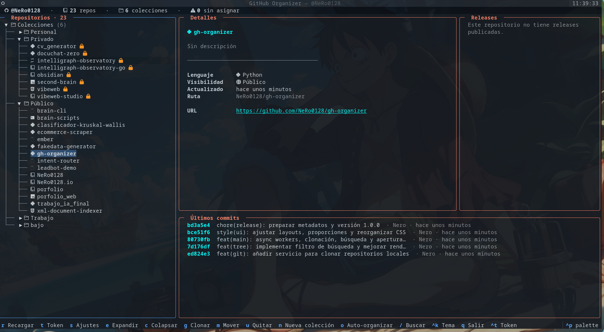

# 🗂️ gh-organizer

> **Tame the chaos of your repositories.** A beautiful TUI to organize your GitHub repos into custom collections, right from your terminal.


---

## 📸 Preview



---

## 🎯 The Problem and the Solution

If you're a developer, you probably know this feeling: you open your GitHub account and find **dozens (or hundreds) of repositories** mixed together with no order whatsoever. Work projects next to side-projects, forgotten forks, experiments from years ago… Finding anything becomes an archaeological dig.

GitHub gives you "stars" and some metadata, but it doesn't let you create **real folders** to structure your work.

**gh-organizer** brings the physical organization of your folders to a **beautiful, fluid terminal interface**: group repos into nested collections, auto-organize by language or visibility, search instantly, and clone with a single shortcut. All async, all local, all in a readable TOML file.

---

## ✨ Features

- 📁 **Nested collections** — Organize your repos in folders within folders (e.g., `Work/Clients/Web`).
- 🪄 **Magic auto-organization** — Automatically create collections by language, visibility, or both, with a single command.
- 🔍 **Instant search** — Filter repositories in real time as you type.
- ⚡ **100% async** — Background data loading; the UI **never freezes**.
- 📊 **Details panel** — Recent commits and releases for each repo, without leaving your terminal.
- 📥 **Background cloning** — Clone any repo with a shortcut, without blocking your flow.
- 💾 **TOML persistence** — Your organization lives in a single readable file: `~/.config/gh-organizer/config.toml`.
- 🎨 **Themes and Nerd Fonts** — Customize the look and enjoy beautiful icons in your terminal.

---

## 🚀 Installation

### Recommended: `uv`

```bash
uv tool install gh-organizer
```

### Alternative: `pipx`

```bash
pipx install gh-organizer
```

### 🔑 GitHub Token

`gh-organizer` needs a _Personal Access Token_ (PAT) to query the GitHub API:

1. Go to [github.com/settings/tokens](https://github.com/settings/tokens) → **Generate new token (classic)**.
2. Grant the **`repo`** scope (or `public_repo` if you only use public repos).
3. Store it securely and paste it when `gh-organizer` prompts you on first launch.

> **Tip:** You can also export it as an environment variable: `export GITHUB_TOKEN=your_token_here`

---

## ⌨️ Usage and Keyboard Shortcuts

Launch the TUI with:

```bash
gh-organizer
```

| Shortcut | Action                                         |
| :------: | ---------------------------------------------- |
|   `m`    | Move selected repo(s) to a collection          |
|   `o`    | Auto-organize by language, visibility, or both |
|   `g`    | Clone the repository in the background         |
|   `/`    | Search / filter repositories                   |
| `Enter`  | View details (recent commits and releases)     |
|   `n`    | Create a new collection                        |
|   `r`    | Refresh data from GitHub                       |
|   `?`    | Show shortcuts help                            |
|   `q`    | Quit                                           |

---

## ⚙️ Configuration

Everything lives in a single TOML file:

```toml
# ~/.config/github-organizer/config.toml

[preferences]
theme = "github"             # github | tokyo-night | catppuccin-mocha | github-light
language = "auto"            # auto | es | en
clone_dir = "~/github"       # Where repos are cloned
tree_mode = "remember"       # remember | expanded | collapsed
nerd_fonts = true            # Language icons in the UI

[folders]
"Work/Web" = ["my-website", "my-docs"]

[tree_state]
expanded = ["Work", "Work/Web"]
```

You can customize the theme, the language, the default clone directory and how
the tree is restored. Edit it with your favorite editor; changes apply on restart
(the language can also be changed live from the Settings screen with `s`).

---

## 🌍 Languages

The interface is available in **Spanish** (source language) and **English**.
By default the app follows your system locale (`LANG`/`LC_ALL`, then
`locale.getlocale()`); if the locale is not supported it falls back to Spanish.
Change it at any time in **Settings → Idioma**, or with `language = "es" | "en" | "auto"`
in `config.toml`.

Translations live in `src/gh_organizer/locales/<lang>/LC_MESSAGES/gh_organizer.po`.

<details>
<summary>Adding a new language</summary>

```bash
# 1. Create the catalog skeleton (one empty msgstr per msgid)
uv run python scripts/i18n.py new-lang fr

# 2. Translate it. Then compile .po → .mo
uv run python scripts/i18n.py compile

# 3. Check what is still missing
uv run python scripts/i18n.py stats
```

Finally add the code to `SUPPORTED_LANGUAGES` in `src/gh_organizer/i18n.py` and to
`VALID_LANGUAGES` / `LANGUAGE_NAMES` in `src/gh_organizer/services/preferences.py`.
The `.mo` files are committed, so a plain `uv sync` is enough to ship the new
language (the PyInstaller build copies `locales/` automatically).

</details>

---

## 🤝 Development and Contributing

Contributions are more than welcome! Whether you want to add code, report a bug, or propose an idea:

```bash
# 1. Clone the repository
git clone https://github.com/your-username/gh-organizer.git
cd gh-organizer

# 2. Install dependencies (incl. dev)
uv sync

# 3. Run the test suite
uv run pytest

# 4. Check code style
uv run ruff check src tests scripts
```

- 🐛 **Found a bug?** Open an [Issue](https://github.com/your-username/gh-organizer/issues).
- 💡 **Have an idea?** [Pull Requests](https://github.com/your-username/gh-organizer/pulls) are welcome, big or small.
- 📝 **First open source contribution?** Don't be afraid! Check out issues labeled `good first issue` and we'll gladly help you.

---

## 📄 License

This project is under the **MIT License**. You're free to use, modify, and distribute it. See the [`LICENSE`](LICENSE) file for details.

---

<div align="center">

**Made with ❤️ and Python** by and for developers.

⭐ If `gh-organizer` saved you from repository chaos, consider giving it a star on GitHub.

</div>
